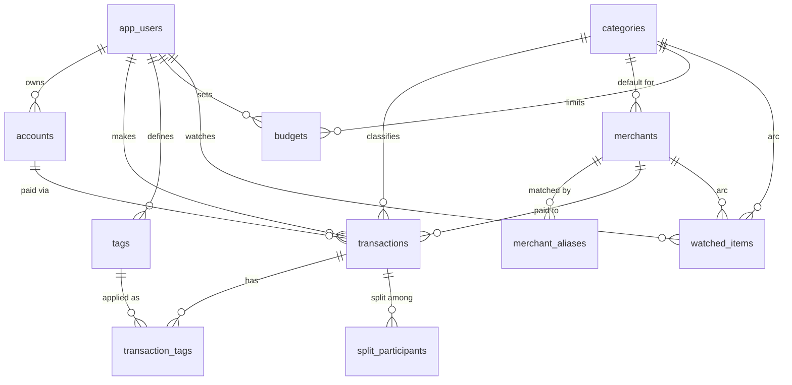

# FinanceSimply (SpendSense)

FinanceSimply is a privacy-first, on-device Android application designed to track and manage your expenses intelligently without compromising your financial data.

## Features

- **Supabase (PostgreSQL) Backed**: Data lives in a Supabase Postgres database (single-user test/academic setup) and is also viewable from a browser app in `web/`. The original on-device Room/SQLite store has been replaced.
- **Premium Dynamic Dark Mode**: Features a highly legible, beautifully designed deep charcoal surface with indigo primary accents and semantic color coding for budgets.
- **Split with Friends**: Easily split expenses and capture precise "budget impacts" so you only track what you actually spent. The app automatically calculates "Owed to You" from pending splits.
- **Smart Context Capture**: Whenever an expense occurs, an intuitive bottom sheet allows you to effortlessly classify the transaction, add notes, and define splits.
- **Customizable Monthly Budgeting**: Set your monthly budgets and visually track how much is remaining.
- **Addiction & Pattern Tracking**: Monitor specific categories or merchants to track spending addictions.
- **No Manual Entry Required (Upcoming)**: Import historical expenses securely.

## Tech Stack

- **Platform**: Android
- **Language**: Kotlin
- **UI Framework**: Jetpack Compose
- **Database**: Supabase (PostgreSQL) accessed over PostgREST with OkHttp; browser client uses supabase-js
- **JSON Serialization**: Gson

## Technical Architecture & Codebase Structure

The application strictly follows the **MVVM (Model-View-ViewModel)** architectural pattern. Supabase (PostgreSQL) is the single source of truth, heavily leveraging Kotlin Coroutines and `StateFlow` for reactive UI updates.

### 1. Data Layer (`com.example.financesimply.data`)
- **`SpendSenseDatabase`**: Thin entry point exposing the three DAOs. No longer a Room database; see "Database (Supabase)" below.
- **`TransactionEntity`**: The core data model. It tracks the raw merchant name, amount, category, tags, and specific variables like `budgetImpactAmount` (which differs from `amount` if a bill was split).
- **`SplitParticipant`**: A data class detailing split bills (e.g., who owes what). It is stored in the normalised `split_participants` table.
- **`TransactionDao`** (and `FavoriteOutletDao`, `WatchedItemDao`): Same method names as before, now backed by `data/remote/SupabaseClient.kt`. Flow-based queries re-run after each write and every 5 seconds for real-time UI updates (e.g., automatically summing up total expenses vs. budgets).

### 2. UI Layer (`com.example.financesimply.ui`)
- **Jetpack Compose**: The entire app is written in Jetpack Compose, emphasizing a Premium Dark Mode aesthetic (`Color.kt`, `Theme.kt`).
- **`SpendSenseApp.kt`**: The root Compose navigation host. It also hosts the global `ContextCaptureSheet` overlay.

#### Screens (`ui.screen`)
- **`DashboardScreen`**: The main hub. It renders budget progression bars, the "Owed to You" summary, and quick stats.
- **`TransactionsScreen`**: A chronologically ordered feed of transactions. It utilizes `FilterChips` to let users quickly pivot between "All", "Untagged", and "Splits".
- **`SettingsScreen`**: Manages user budgets, favorite outlets (Regex mappings), monitored packages, and addiction trackers.

#### Components (`ui.component`)
- **`ContextCaptureSheet`**: The dynamic bottom sheet that appears when a transaction is detected (or tapped). It allows users to categorize, tag, and execute "Split Bill" mathematics instantly.
- **`TransactionCard`**: The reusable Compose element for rendering individual transactions. It has built-in logic to visually differentiate Split transactions and standard transactions.

### 3. State Management (`ui.viewmodel`)
- **`DashboardViewModel`**: Computes macro-level math. Queries the DB to determine total amount spent in a month, remaining budget, and pending split money owed to the user.
- **`ContextCaptureViewModel`**: Handles the volatile state of tagging a transaction. It encapsulates the math for automatically dividing split bills evenly among participants before committing to the DB.
- **`TransactionListViewModel`**: Exposes the stream of all transactions to the `TransactionsScreen` and manages active view filters.

### 4. Background Services (`worker`)
- **`UntaggedReminderWorker`**: Uses Android's WorkManager to check the database for pending/untagged transactions. If you ignore notifications, this worker will politely remind you to tag them to keep your budget accurate.

## Database (Supabase)

Everything under `supabase/` is plain SQL, applied in order. Project: `epsccrintpcctkvbaiin` (test project, single user, open RLS).

| File | Purpose |
|---|---|
| `01_schema.sql` | Tables, constraints, indexes, triggers, RLS |
| `02_views_functions.sql` | Reporting views (joins, aggregates, lateral join) |
| `03_seed.sql` | Dummy data: 4 users, accounts, merchants, ~44 transactions, splits, tags, budgets, watchlist |
| `04_queries.sql` | 15 DBMS demo queries: all join types, subqueries, window functions, CTEs, set ops, transaction |
| `05_android_api.sql` | Views and RPC functions the Android app calls (`v_android_*`, `upsert_transaction`, aggregates) |
| `apply.sh` | `DB_PASSWORD='...' ./supabase/apply.sh` runs 01, 02, 03 and 05 through the Supabase session pooler |

The direct host `db.<ref>.supabase.co` is IPv6-only; `apply.sh` uses `aws-0-ap-northeast-1.pooler.supabase.com` with user `postgres.<ref>`. Seed is not idempotent: re-running adds duplicate transactions.

### Entity-relationship diagram

### Tables

| Table | Key columns | Notes |
|---|---|---|
| `app_users` | `id` PK, `email` UNIQUE + format CHECK | Android app uses the lowest id (`app_user_id()`) |
| `accounts` | `user_id` FK CASCADE, UNIQUE(user, name) | `kind` ENUM BANK/WALLET/CARD/UPI; `source_app` = GPay etc. |
| `categories` | `name` UNIQUE | Global lookup |
| `tags` | UNIQUE(user, name) | Per user |
| `merchants` | `friendly_name` UNIQUE, `default_category_id` FK SET NULL | Replaces `favorite_outlets` |
| `merchant_aliases` | `raw_pattern` UNIQUE, `merchant_id` FK CASCADE | Raw notification text patterns |
| `transactions` | `amount` CHECK > 0, `budget_impact` CHECK 0..amount, UNIQUE(user, `notification_hash`) partial | Core fact table; ENUM `transaction_type`, `status` |
| `transaction_tags` | PK(transaction, tag) | M:N junction |
| `split_participants` | UNIQUE(transaction, name) | Replaces the JSON `splitDetails` column |
| `watched_items` | exclusive-arc CHECK: exactly one of `category_id` / `merchant_id` | Addiction tracker |
| `budgets` | UNIQUE NULLS NOT DISTINCT (user, category) | NULL category = overall budget |

### Normalisation and integrity

- 1NF: JSON `splitDetails` became rows in `split_participants`. 2NF/3NF: repeated category and merchant strings moved to lookup tables; single `tag` became M:N.
- Types: epoch milliseconds became `timestamptz`, `REAL` became `numeric(12,2)`, string enums became Postgres ENUMs.
- Triggers: `updated_at` maintenance, merchant and category auto-resolution from aliases on insert, `budget_impact` defaulting (0 when exempt), deferred check that split totals do not exceed the transaction amount.
- Indexes: user + time, category, merchant, partial index on `PENDING`, trigram GIN on `merchant_raw`.
- Views: `v_transactions`, `v_monthly_summary`, `v_category_breakdown`, `v_top_merchants`, `v_daily_spend`, `v_budget_status` (LEFT JOIN LATERAL), `v_split_balances`.
- Row Level Security is enabled but the policies are open to `anon` (test project). Scope them with `auth.uid()` before any real use.

### Room to Postgres mapping

| Room | Postgres |
|---|---|
| `transactions.splitDetails` (JSON) | `split_participants` |
| `transactions.category`, `tag`, `merchantFriendly` (strings) | `categories`, `tags` + `transaction_tags`, `merchants` |
| `favorite_outlets` | `merchants` + `merchant_aliases` |
| `watched_items(type, value)` | `watched_items` with FK arc |
| DAO `@Query` aggregates | `monthly_total`, `category_breakdown`, `top_outlets`, `daily_spend_trend`, ... (RPC) |
| Entity rows | `v_android_txn`, `v_android_outlets`, `v_android_watched` (column names match the Kotlin fields, so Gson maps them directly) |

### Android data layer

`data/remote/SupabaseClient.kt` wraps PostgREST (`get`, `rpc`, `watch`). The three DAOs keep their old method names, so ViewModels, workers and the notification listener are unchanged. Network failures are caught (`SupabaseClient.safe`) so writes return `-1` and reads return empty instead of crashing; a transaction captured while offline is dropped. Flows poll every 5 seconds and refresh after local writes.

### Web app

`web/index.html` + `web/config.js` (supabase-js). Run `cd web && npx serve .`. Tabs: Dashboard, Transactions (add, tag, dismiss, delete), Splits, Budgets, Merchants, Watchlist, Reports. A user switcher lets you see each dummy user's data.

### Verification done

- All SQL files applied to the live project; the 15 queries in `04_queries.sql` run without errors.
- Data layer (`data/db`, `data/remote`) compiled with Kotlin 2.0.21 on JDK 17 and exercised against the live database: 28 checks covering every DAO method (insert/update round trip, splits, tags, alias resolution, aggregates, outlets, watchlist, offline-safe error path). All passed.
- Web app REST calls and JS syntax checked.
- Not verified: the full Android Gradle build, UI screens and notification listener on a device.

### Secrets

Only the anon key is in the code (`SupabaseClient.kt`, `web/config.js`). Because RLS is open, anyone with it has full access to this test database. The service-role key and database password are not stored in the repo. Rotate keys when the project ends.

## Getting Started

Since FinanceSimply requires specific Android permissions to intercept transaction notifications and read SMS (upcoming feature), this application is designed to be sideloaded.

1. Clone this repository.
2. Open the project in Android Studio.
3. Run the app on your physical device or emulator.
4. Apply `supabase/*.sql` (see above) so the database exists.
5. Grant the necessary **Notification Access** permission when prompted to enable automatic transaction capture.

## Contributing

Pull requests are welcome. For major changes, please open an issue first to discuss what you would like to change.
